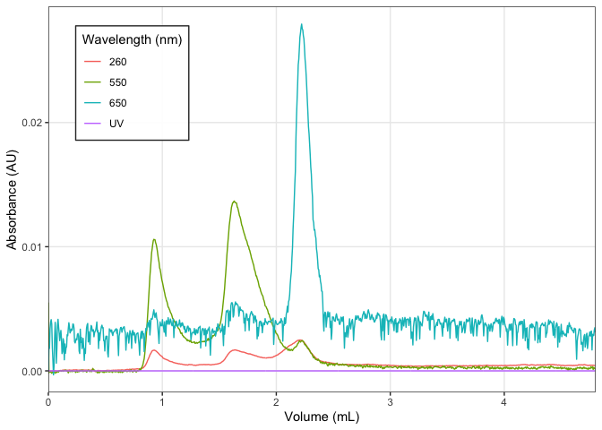
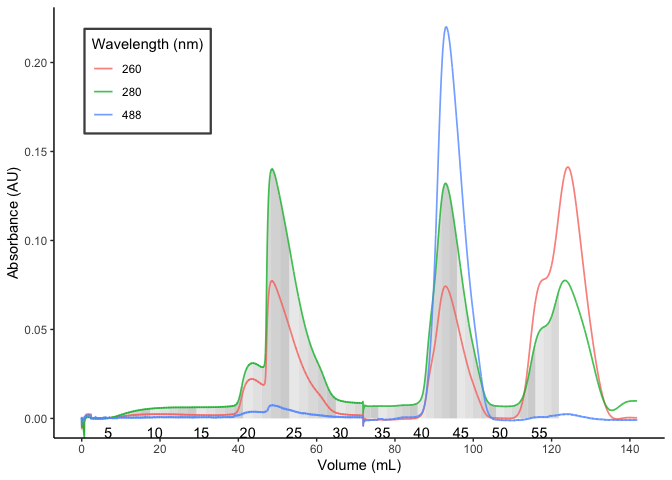
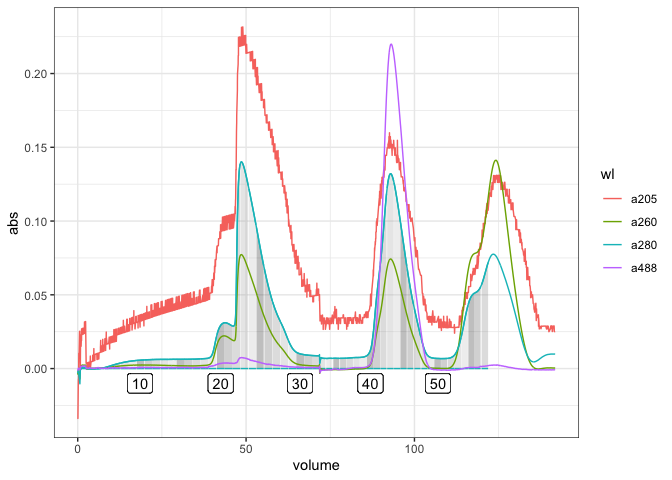

<!-- README.md is generated from README.qmd. Please edit that file -->

# chromr

<!-- badges: start -->

[](https://app.codecov.io/gh/BradyAJohnston/chromr?branch=main)
[](https://github.com/BradyAJohnston/chromr/actions/workflows/R-CMD-check.yaml)

<!-- badges: end -->

chromr reads chromatograms exported from FPLC instruments, the BioRad
QuadTec and NGC and the ÄKTA, into tidy data frames, and plots them with
their fractions.

## Installation

You can install the development version of chromr from
[R-Universe](https://bradyajohnston.r-universe.dev) with:

``` r
install.packages(
  "chromr",
  repos = c("https://bradyajohnston.r-universe.dev", "https://cloud.r-project.org")
)
```

## Example

Reading of chromatogram files and plotting from the BioRad QuadTech.

``` r
library(chromr)
library(ggplot2)
```

``` r
fl <- system.file(
  "extdata",
  "example_quadtec_3.txt", 
  package = "chromr"
)

dat <- fl |> 
  chrom_read_quadtech()
dat
#> # A chromatogram: 960 × 10
#> # Instrument:     BioRad QuadTec
#> # Run:            20220801_dsnPPR10_Cy3_1_AF647_2
#> # Date:           02:10:17 PM 08-01-22
#>     time  volume    a280     a260     a550     a650   uv percent_b conductivity
#>    <dbl>   <dbl>    <AU>     <AU>     <AU>     <AU> <AU>     <dbl>        <dbl>
#>  1     0 0        0       0        5.51e-3  0          0         0         16.0
#>  2     1 0.00501  4  e-6  1.3 e-5 -1.6 e-4  1.87e-3    0         0         16.0
#>  3     2 0.0100   0      -8   e-6 -6.40e-5  1.80e-3    0         0         16.0
#>  4     3 0.0150  -1.3e-5 -2.20e-5 -6.40e-5  3.39e-3    0         0         16.0
#>  5     4 0.0200  -6  e-6 -1.5 e-5 -9.5 e-5  3.91e-3    0         0         16.0
#>  6     5 0.0250  -6  e-6 -1.80e-5 -1.28e-4  4.13e-3    0         0         16.0
#>  7     6 0.0300  -6  e-6 -2.90e-5 -1.93e-4  3.76e-3    0         0         16.0
#>  8     7 0.0350  -2  e-6 -8   e-6 -1.28e-4  1.92e-3    0         0         16.0
#>  9     8 0.0400   3  e-6 -1.10e-5 -6.40e-5  8.83e-4    0         0         16.0
#> 10     9 0.0450  -8  e-6 -9   e-6 -9.60e-5 -3.2 e-4    0         0         16.0
#> # ℹ 950 more rows
#> # ℹ 1 more variable: pressure <dbl>
```

``` r
dat |> 
  dplyr::select(-a280) |> 
  chrom_plot(ylim = c())
```



``` r
fl <- system.file(
  "extdata",
  "example_quadtec_4.txt", 
  package = "chromr"
)

fl |> 
  chrom_read_quadtech() |> 
  chrom_add_volume(0.3) |> 
  chrom_plot(xlim = c(0, 3), ylim = c(NA, 0.01))
```



## Fractions2

``` r
fl1 <- system.file("extdata", "example_quadtec_1.TXT", package = "chromr")
fl2 <- system.file("extdata", "example_quadtec_2.TXT", package = "chromr")
df1 <- chrom_read_quadtech(fl1)
df2 <- chrom_read_quadtech(fl2)
dat <- chrom_append_run(df1, df2)

dat |>
  dplyr::slice_sample(prop = 0.1) |>
  pivot_wl_longer() |>
  ggplot(aes(volume, abs, fraction = fraction, group = wl)) +
  geom_fraction_bars(aes(color = wl), lines = "a280") +
  
  geom_line(aes(color = wl)) +
  geom_fraction_label(colour = "black", ypos = -0.01, period = 10) +
  scale_fill_grey() +
  theme_bw()
```



## Units, fractions and wells

Every reader gives the same columns, and records the run it came from.
Absorbance columns know their wavelength and unit, so plots are labelled
with the unit, and joining runs in AU and mAU converts them to mAU.

``` r
ngc <- chrom_read_ngc(system.file("extdata", "ngc_sec.csv", package = "chromr"))
ngc
#> # A chromatogram: 6,510 × 6
#> # Instrument:     BioRad NGC
#> # Run:            20191126_IMAC
#>      volume   a260   a280 conductivity percent_b pressure
#>       <dbl>  <mAU>  <mAU>        <dbl>     <dbl>    <dbl>
#>  1 0.000500  0.747   0            28.0         0    NA   
#>  2 0.00503   1.10    0            28.0         0     5   
#>  3 0.0104    0.784 NaN            28.0         0     5   
#>  4 0.0147    0.784 NaN            28.0         0     5   
#>  5 0.0213   -1.26  NaN            28.0         0     5   
#>  6 0.0280   -3.21  NaN            28.0         0     5   
#>  7 0.0347   -4.56   -8.57         27.7         0     5   
#>  8 0.0413   -5.45   -8.58         27.8         0     5.55
#>  9 0.0480   -6.05   -8.39         27.7         0     6.09
#> 10 0.0547   -6.39   -8.12         27.7         0     6.64
#> # ℹ 6,500 more rows

chrom_meta(ngc)$units
#>       volume conductivity    percent_b     pressure 
#>         "mL"      "mS/cm"          "%"        "psi"
```

Dividing absorbance gives a plain ratio, such as A260/A280:

``` r
ngc |>
  dplyr::filter(volume > 10) |>
  dplyr::mutate(ratio = a260 / a280) |>
  dplyr::select(volume, a260, a280, ratio)
#> # A chromatogram: 5,602 × 4
#> # Instrument:     BioRad NGC
#> # Run:            20191126_IMAC
#>    volume  a260  a280 ratio
#>     <dbl> <mAU> <mAU> <dbl>
#>  1   10.0  507.  551. 0.921
#>  2   10.0  507.  551. 0.921
#>  3   10.0  506.  549. 0.922
#>  4   10.1  505.  548. 0.922
#>  5   10.1  504.  547. 0.922
#>  6   10.1  503.  545. 0.922
#>  7   10.1  502.  544. 0.923
#>  8   10.1  501.  543. 0.923
#>  9   10.1  500.  542. 0.923
#> 10   10.2  499.  540. 0.924
#> # ℹ 5,592 more rows
```

`chrom_fractions()` gives the volumes each fraction covers, and
`fraction_to_well()` the well of the collection plate each fraction went
into, as [wellr](https://bradyajohnston.github.io/wellr/) well IDs,
ready to join to plate-reader data.

``` r
akta <- read_akta_old(system.file("extdata", "example_akta_2.asc", package = "chromr"))

chrom_fractions(akta) |>
  dplyr::mutate(well = fraction_to_well(fraction))
#> # A tibble: 73 × 4
#>    fraction start   end well     
#>      <frac> <dbl> <dbl> <well:96>
#>  1        1  9.11  11.0 A01      
#>  2        2 11.0   13.1 A02      
#>  3        3 13.1   15.0 A03      
#>  4        4 15.0   17.1 A04      
#>  5        5 17.1   19.0 A05      
#>  6        6 19.0   21.1 A06      
#>  7        7 21.1   23.0 A07      
#>  8        8 23.0   25.1 A08      
#>  9        9 25.1   27.2 A09      
#> 10       10 27.2   29.1 A10      
#> # ℹ 63 more rows
```
