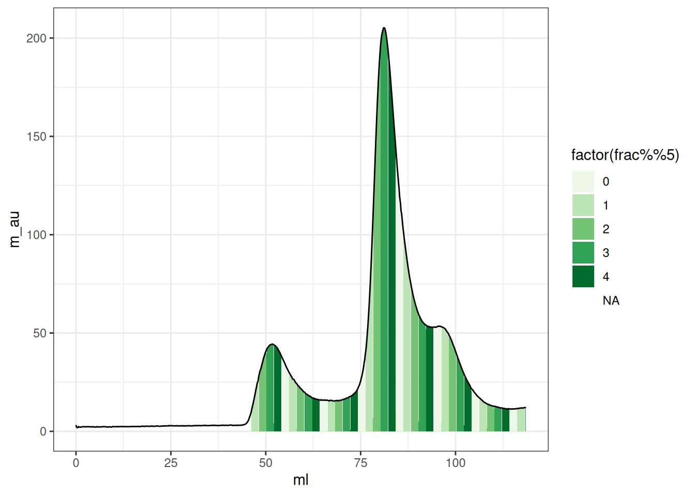

# akta

``` r

library(chromr)
```

``` r

library(ggplot2)
library(tidyr)
library(dplyr)
#> 
#> Attaching package: 'dplyr'
#> The following objects are masked from 'package:stats':
#> 
#>     filter, lag
#> The following objects are masked from 'package:base':
#> 
#>     intersect, setdiff, setequal, union


fl <- system.file(
   "extdata",
   "example_akta_1.asc",
   package = "chromr"
 )

df <- readr::read_tsv(fl, skip = 2)
#> New names:
#> • `ml` -> `ml...1`
#> • `ml` -> `ml...3`
#> Rows: 892 Columns: 4
#> ── Column specification ────────────────────────────────────────────────────────
#> Delimiter: "\t"
#> chr (1): (Fractions)
#> dbl (3): ml...1, mAU, ml...3
#> 
#> ℹ Use `spec()` to retrieve the full column specification for this data.
#> ℹ Specify the column types or set `show_col_types = FALSE` to quiet this message.
head(df)
#> # A tibble: 6 × 4
#>   ml...1   mAU ml...3 `(Fractions)`
#>    <dbl> <dbl>  <dbl> <chr>        
#> 1  0     2053.   46.2 1            
#> 2  0.133 2052.   48.2 2            
#> 3  0.266 2052.   50.2 3            
#> 4  0.4   2052.   52.2 4            
#> 5  0.533 2052.   54.2 5            
#> 6  0.666 2052.   56.2 6

colnames(df) <- c("ml_1", "m_au", "ml_2", "fractions")
head(df)
#> # A tibble: 6 × 4
#>    ml_1  m_au  ml_2 fractions
#>   <dbl> <dbl> <dbl> <chr>    
#> 1 0     2053.  46.2 1        
#> 2 0.133 2052.  48.2 2        
#> 3 0.266 2052.  50.2 3        
#> 4 0.4   2052.  52.2 4        
#> 5 0.533 2052.  54.2 5        
#> 6 0.666 2052.  56.2 6

df_fractions <- df |>
  dplyr::select(matches("fraction") - 1, matches("fraction")) |>
    dplyr::rename(ml = 1) |>
  drop_na()
data <- df |>
  dplyr::select(
    -c(matches("fraction"), matches("fraction") - 1)
  ) |>
  dplyr::rename(ml = 1)

data |>
  mutate(
    m_au = m_au - 2050,
    frac = cut(ml, breaks = df_fractions$ml, labels = FALSE)
  ) |>
  ggplot(aes(ml, m_au)) +
  geom_area(aes(fill = factor(frac %% 5), group = frac), na.rm = TRUE) +
  geom_line() +
  scale_fill_brewer(palette = 5) +
  theme_bw() -> plt

plt
#> Warning: Removed 1 row containing missing values or values outside the scale range
#> (`geom_line()`).
```



## An interactive Plot

``` r

plotly::ggplotly(plt)
```
