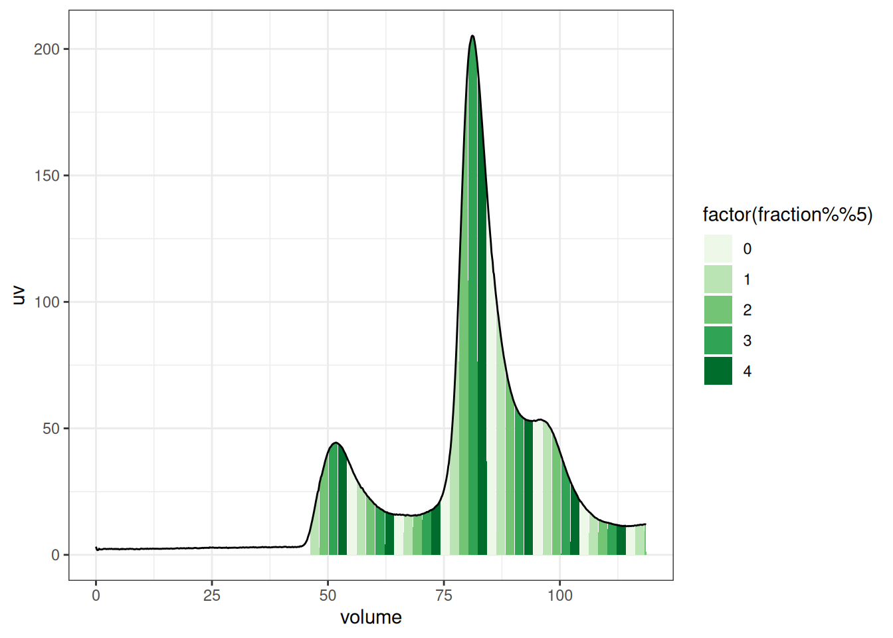

# akta

``` r

library(chromr)
```

``` r

library(ggplot2)
library(dplyr)
#> 
#> Attaching package: 'dplyr'
#> The following objects are masked from 'package:stats':
#> 
#>     filter, lag
#> The following objects are masked from 'package:base':
#> 
#>     intersect, setdiff, setequal, union

fl <- system.file(
  "extdata",
  "example_akta_1.asc",
  package = "chromr"
)

dat <- read_akta_old(fl)
dat
#> # A chromatogram: 891 × 3
#> # Instrument:     ÄKTA
#> # Run:            20220817 DAZAP1 WA construct 2001:10
#>    volume fraction    uv
#>      <mL>   <frac> <mAU>
#>  1  0           NA 2053.
#>  2  0.133       NA 2052.
#>  3  0.266       NA 2052.
#>  4  0.4         NA 2052.
#>  5  0.533       NA 2052.
#>  6  0.666       NA 2052.
#>  7  0.799       NA 2052.
#>  8  0.932       NA 2052.
#>  9  1.07        NA 2052.
#> 10  1.20        NA 2052.
#> # ℹ 881 more rows
```

The fraction marks give the fraction each point was collected into, and
[`chrom_fractions()`](https://bradyajohnston.github.io/chromr/reference/chrom_fractions.md)
gives the volumes each fraction covers.

``` r

chrom_fractions(dat)
#> # A tibble: 37 × 3
#>    fraction start  end
#>      <frac>  <mL> <mL>
#>  1        1  46.2 48.2
#>  2        2  48.2 50.2
#>  3        3  50.2 52.2
#>  4        4  52.2 54.2
#>  5        5  54.2 56.2
#>  6        6  56.2 58.2
#>  7        7  58.2 60.2
#>  8        8  60.2 62.3
#>  9        9  62.3 64.3
#> 10       10  64.3 66.3
#> # ℹ 27 more rows
```

``` r

plt <- dat |>
  mutate(uv = uv - 2050) |>
  ggplot(aes(volume, uv)) +
  geom_area(
    aes(fill = factor(fraction %% 5), group = fraction),
    data = \(d) filter(d, !is.na(fraction))
  ) +
  geom_line() +
  scale_fill_brewer(palette = 5) +
  theme_bw()

plt
```



## An interactive Plot

``` r

plotly::ggplotly(plt)
```
